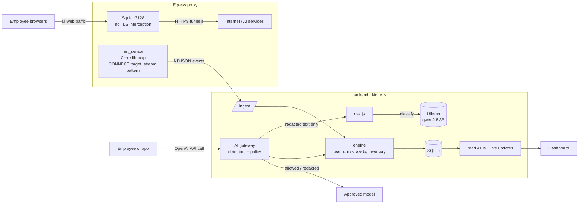

# Lantern: Shadow AI & data protection

Employees paste code, contracts and client data into public AI tools every day, and IT usually doesn't know.
Lantern **finds the AI tools in use**, **catches sensitive data before it reaches an AI service**, and
**enforces a policy (allow, warn, redact or block)** with a small **local LLM** that judges each prompt's risk
and explains its decision. All employee web traffic goes through a **Squid egress proxy**, where a passive sensor
spots AI use, including AI services that no blocklist knows about.

> **Prototype notice:** Lantern is not a ready-to-use or production-ready product. Some functionality is incomplete, experimental, or still to be implemented, and the current behavior should not be relied on for production security or data-loss prevention.

## Run it

```sh
git clone <this repo> && cd Lantern
docker compose up --build
```

Open **http://localhost:8080**. Employees' browsers (or a PAC/WPAD file, or group policy) point to the proxy at
**`<host>:3128`**. The first start downloads two local models in the background: the risk model (qwen2.5 3B, about 2 GB)
and a smaller chat model that answers through the gateway (qwen2.5 1.5B, about 1 GB). Until the download finishes,
decisions use the rules alone, and the dashboard works straight away with synthetic demo data.
The **AI Gateway** page is at **http://localhost:8080/gateway.html**. The **Risk AI** pill in the top bar shows whether
the GenAI risk model is answering (green) or decisions are falling back to the rules alone (red).

| Optional setting (`.env`, see `.env.example`) | |
|---|---|
| `LLM_BASE_URL`, `LLM_MODEL`, `LLM_API_KEY` | Use the OpenAI API (or any OpenAI-compatible API) for risk decisions instead of the local model |
| `LANTERN_UPSTREAM`, `LANTERN_UPSTREAM_KEY`, `LANTERN_UPSTREAM_MODEL` | The model that answers through the gateway. Default: the local chat model. Point it at OpenAI for fast answers in a live demo |
| `LANTERN_DEMO=0` | Start with an empty database |

Keys go only in `.env`, which is git-ignored.

## A 3-minute demo

1. Open the **AI Gateway** page (top bar): a chat that goes through Lantern. Pick an example (*Client IBAN*, *Client contract*,
   *API key*, *Prompt injection*), a user and a model. While you type, a quick check shows what the rules found. Press *Send*:
   you see the action, the risk score and the LLM's explanation, plus exactly what was sent on to the model. For example,
   the IBAN is replaced by `[IBAN-1]`. Allowed messages get a real answer, streamed from the model.
2. Switch the model to one marked *not approved* and send the same prompt: the risk goes up and the action becomes stricter.
3. **Detect a known AI tool at the proxy.** Keep the dashboard (**http://localhost:8080**) open. In a terminal on the
   machine that runs Docker, send a request through the proxy, the way an employee's browser would:
   ```sh
   curl -sS -o /dev/null -w 'HTTP %{http_code}\n' -x http://localhost:3128 https://chatgpt.com
   ```
   It prints an HTTP status (whatever chatgpt.com answers; any code is fine). Within a second, **Live alerts** shows
   *Shadow AI domain chatgpt.com*. This needs internet access.
4. **Detect an AI service that no list knows, by its traffic alone.** `docker compose up` also started `fake-llm`, a small
   HTTPS server ([`scripts/fake_llm.py`](scripts/fake_llm.py)) that streams its reply token by token, as chat AIs do.
   It is not on any list of AI domains. Send it a prompt through the proxy:
   ```sh
   curl -sSk -x http://localhost:3128 https://fake-llm:8443 -d '{"prompt": "Summarise our Q3 sales numbers"}'
   ```
   You should see 80 lines like `data: {"token": "word0 "}` arrive over about 3 seconds. About 2 seconds after the
   last one, **Live alerts** shows *LLM streaming pattern to fake-llm (score 1.00)*, and `fake-llm` appears in the
   **AI app inventory** as an unknown AI. The traffic is encrypted end to end: the sensor never sees the words, only the
   rhythm of the packets (a request, then many small packets at a steady pace).
   (`-x` sends the request through the proxy, `-k` accepts the fake server's self-signed certificate, `-sS` hides the
   progress bar but still shows errors.)

   | If you see | It means | Fix |
   |---|---|---|
   | `CONNECT tunnel failed, response 503` | The proxy can't reach `fake-llm` | `docker compose up -d fake-llm`, then `docker compose logs fake-llm` should say `fake LLM on port 8443` |
   | `CONNECT tunnel failed, response 403` | The proxy refused your address: it only serves private networks | Run curl on the machine that runs Docker, with `localhost` as above |
   | `Failed to connect to localhost port 3128` | The proxy isn't running | `docker compose up -d squid sensor` |
   | No new alert when you run it again | One alert per user, app and reason every 5 minutes (`dedup_window_seconds` in `config/policy.yaml`) | Each run still appears under **Recent events** |

5. The live feed, chart, AI tool inventory (with risk ratings) and per-user risk update as you go.

## Main features

| Challenge goal | How Lantern does it |
|---|---|
| **Discover AI tools in use, approved or not** | All employee traffic goes through a **Squid proxy**. A passive sensor (C++) in the proxy's network reads each `CONNECT` destination and recognises the *prompt → streamed reply* traffic pattern of LLMs, even to unknown servers and without decrypting anything. Everything goes into an **AI tool inventory with risk ratings**. |
| **Detect sensitive data before it reaches an AI service** | An OpenAI-compatible **AI gateway**. Checksum-validated detectors find IBANs, cards (Luhn), Greek AMKA and AFM, API keys and private keys; pattern detectors find phone numbers, emails, street addresses and named clients. A **local LLM** classifies the context (client data, confidential, personal data, source code, credentials, prompt injection). |
| **Enforce a policy: allow, warn, redact, block** | Risk 0–100, then an action, using thresholds in [`config/policy.yaml`](config/policy.yaml). Redact removes the detected values and forwards the prompt; block stops it at the gateway. Every decision includes an explanation for the user and the analyst. |
| **Bonus: prompt injection** | Rule patterns plus the LLM's own `prompt_injection` category, both blocked. |
| **Risk & policy model** | Policy, risk ratings, approved models and AI domains are plain YAML, reloaded on change. A synthetic employee directory maps IP addresses and users to teams. |

## Architecture



| Part | Path |
|---|---|
| Egress proxy: Squid (Canonical's `ubuntu/squid` image), config in `config/squid.conf` | `config/squid.conf` |
| Network sensor: C++17, libpcap, OpenSSL, JA4 fingerprints; shares the proxy's network namespace | `net_sensor/` |
| Backend: Node 22, Express, built-in SQLite, live updates over Server-Sent Events (SSE) | `backend/` |
| Risk decision + LLM client | `backend/risk.js` |
| Gateway enforcement | `backend/gateway.js` |
| Dashboard: plain HTML/JS, no build step, light and dark themes, works on narrow screens; the time window applies to every panel | `public/index.html`, `app.js` |
| AI Gateway page: chat through the gateway with streamed answers, a quick check while typing, the policy in plain words, your own recent decisions, and a code snippet for any OpenAI-compatible tool (`/gateway/v1`, including `/v1/models`) | `public/gateway.html`, `gateway.js` |
| Policy, AI domains, directory, proxy | `config/` |

### How a prompt is decided

1. The detectors find values (IBAN, AMKA, keys and so on) and the **rule risk** comes from `data_risk`.
2. The prompt is **redacted first**, so the LLM only ever sees `[IBAN-1]`-style tags, never raw values.
3. The LLM **picks a category** and does not pick a number: small models classify far more reliably than they score. The category becomes a risk score through `llm_category_risk`.
4. **Final risk = max(rule risk, LLM risk)**, plus a bonus if the model isn't approved. The LLM can raise the risk but never lower it, so a crafted prompt can't talk its way past a detected API key.
5. The risk maps to an action through `risk_actions`. If the LLM is down, the rules still decide.

### Detection at the proxy

Employees must use the Squid proxy. Squid does **no TLS interception**: each HTTPS request is a `CONNECT host:443`
tunnel, so the content stays encrypted end to end. The sensor shares Squid's network and watches every employee ↔ proxy
connection. It takes the destination from the `CONNECT` request, falling back to the TLS site name (SNI), and spots LLM use **by behaviour**: a client request followed
by a burst of small, regularly spaced server records (one per token) is scored per reply. That catches
self-hosted or unknown AI endpoints that no domain list contains. It also flags large uploads to AI services.
The same sensor can also run on a network tap or mirror port (`-i IFACE`), where it additionally reads DNS and QUIC.

## Accuracy

`docker compose exec backend npm run eval` runs a labelled set of 22 synthetic prompts through the full decision path:

| Mode | Accuracy | Precision (intervened correctly) | Recall (caught what it should) |
|---|---|---|---|
| Rules only | 82% | 100% | 94% |
| Rules + qwen2.5 1.5B | 86% | 94% | 100% |
| **Rules + qwen2.5 3B** (default) | **100%** | **100%** | **100%** |

## Why small local models?

Lantern uses `qwen2.5:3b` for risk classification and `qwen2.5:1.5b` for gateway responses. We chose them to keep downloads and hardware requirements modest, making local setup easier to reproduce without dedicated GPUs or paid API access. With the default Ollama configuration, classification runs locally.

This is a resource trade-off, not a claim of parity with larger models: smaller models can be less accurate, contextual, and consistent. Lantern combines AI classification with deterministic rules, and can be configured to use larger models or other inference backends when resources allow.

## Protecting the data we inspect

- **The data stays in-house:** the LLM runs locally in Docker. Only the not redacted text is ever sent to the answer AI.

- **Synthetic data only:** the demo users, clients and IDs are made up. The IDs are checksum-valid but fictional.

## Limitations

- The proxy must be **mandatory**: the firewall should block direct outbound traffic, including UDP 443 (QUIC), so browsers fall back to the proxy.
- The sensor sees **an IP address, not a person**: the directory maps known IPs to users. Squid proxy authentication would give real usernames.
- Connections from the Docker host itself show Docker's gateway IP; clients on the LAN keep their own IP addresses.
- Chat history lives in the browser tab. Each turn, the rules scan the whole conversation, but the risk LLM judges only the newest message (earlier ones were judged when they were sent).
- On CPU, chat answers take 5–15 s. With `LANTERN_UPSTREAM` pointed at a hosted model they are near-instant.

## Running without Docker

```sh
make -C net_sensor && sudo net_sensor/build/net_sensor -c config/indicators.yaml -i eth0 -p 3128 -j   # on the proxy host; needs libpcap-dev libyaml-cpp-dev libssl-dev
cd backend && npm ci && LLM_BASE_URL=http://localhost:11434/v1 npm start                      # Node >= 22.13
```
