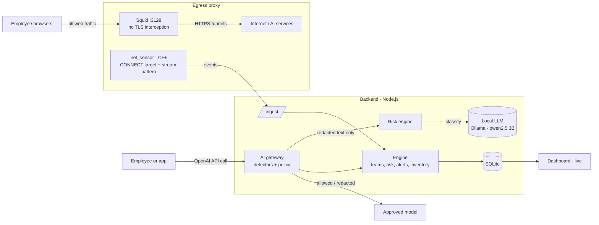

# Lantern: pitch notes

Material for the pitch deck: one section per slide, in a suggested order.
Every number here comes from our own tests on synthetic data.

---

## 1. Title

**Lantern: shining a light on Shadow AI**
Find the AI tools in use. Stop sensitive data before it leaves. Explain every decision.

Netcompany Hackathon Athens 2026 · Challenge 3: Shadow AI protection & Data Protection

---

## 2. The problem

- Employees paste code, contracts and client data into public AI tools every day, and IT usually doesn't know.
- Blocking all AI doesn't work: people switch to their phones, and the company loses the productivity gain.
- Domain blocklists are always out of date: new AI tools and self-hosted models appear every week.
- Simple keyword or regex filters can't tell "how do I sort a list" from "summarise our contract with client Acme".

**The question a security team can't answer today:** *Which AI tools are we using, and what data went into them?*

---

## 3. Our solution in one sentence

Lantern watches AI use **at the network** and checks AI prompts **at a gateway**. Rules plus a small **local** LLM
judge the risk of each prompt, and the policy **allows, warns, redacts or blocks** it, with an explanation for both the user and the analyst.

Three layers, each covering what the others can't see:

| Layer | Sees | Does |
|---|---|---|
| **Squid egress proxy + network sensor** | Every employee connection | Discovers AI tools, including unknown ones, from traffic behaviour |
| **AI gateway** | Prompt content | Detects sensitive data, scores the risk, enforces the policy |
| **Dashboard** | Everything | Inventory with risk ratings, live alerts, per-user and per-team risk |

---

## 4. Architecture



**For a slide, draw it as four boxes left to right:**
Employees → **Squid proxy + sensor** (discover) → **AI gateway + local LLM** (decide and enforce) → **Dashboard** (see and act)

**Runs with one command:** `docker compose up --build` starts five containers: backend, Squid, sensor, Ollama, and a one-shot model download.
On our test machine the stack starts in under a minute; the model download time depends on the network.

| Component | Technology | Size |
|---|---|---|
| Network sensor | C++17, libpcap, OpenSSL | ~2,900 lines |
| Backend + gateway + risk engine | Node.js 22, Express, built-in SQLite | ~1,000 lines |
| Dashboard | Plain HTML/JS/CSS, no build step | ~800 lines |
| Risk LLM | Ollama, qwen2.5 3B, CPU only | 1.9 GB model |
| Proxy | Squid 6 (Canonical image) | config only |

---

## 5. How we discover AI tools (the network sensor)

- All web traffic goes through Squid. **We don't decrypt anything**: HTTPS stays end-to-end encrypted.
- The sensor runs inside the proxy's network and reads the `CONNECT` request, which names the destination (for example `chatgpt.com:443`).
- It checks names against a catalog of 24 AI domains in 4 categories: chat, API, model hub, aggregator.
- **The novel part: behavioural detection.** An LLM reply has a recognisable shape: a request from the user, then a stream of
  small, evenly spaced packets (one per token) for a few seconds. The sensor scores every reply on this shape, so it catches
  AI services **that no list knows about**: self-hosted models, new start-ups, internal proxies.
- It also flags large uploads (1 MiB or more) to AI services: pasted documents and file uploads.
- Every tool found goes into an **inventory with a risk rating**: unknown AI 70, aggregator 60, chat 45, approved model 10.

*Demo proof:* a fake LLM on an unknown server, reached through the proxy, was flagged with a stream score of 1.00, inside an encrypted tunnel.

---

## 6. How we decide on a prompt (the GenAI part)

```
prompt ─► detectors ─► redact ─► local LLM classifies ─► risk = max(rules, LLM) ─► action
          (IBAN, AMKA…)  [IBAN-1]   (client_data, pii…)     (+ unapproved model)     allow / warn / redact / block
```

1. **Detectors with checksums**, not just patterns: IBAN (mod-97), cards (Luhn), Greek **AMKA** (Luhn + date of birth),
   Greek **AFM** (mod-11), API keys (OpenAI, Anthropic, Google, GitHub, AWS), private keys, high-entropy tokens.
2. **Redact before the LLM sees it:** the model only ever sees `[IBAN-1]`, never the real value.
3. **The LLM classifies, it doesn't score:** small models are poor at picking numbers but good at picking categories
   (none, client data, confidential, personal data, financial, credentials, source code, prompt injection).
   The policy file turns each category into a risk score.
4. **The LLM can raise the risk, never lower it:** final risk = max(rule risk, LLM risk). A crafted prompt can't talk its way past a detected API key.
5. **The destination matters:** prompts to a model that isn't approved get +25 risk.
6. **The policy maps risk to an action:** warn from 25, redact from 50, block from 80; prompt injection is always blocked. All of it is configurable in YAML.
7. **Every decision is explained**: one sentence for the user and the analyst, plus the rule reasons.

**Fail-safe:** if the LLM is down or slow, the rules alone still decide. The system never fails open.

---

## 7. Results (how we measured accuracy)

A labelled set of 22 synthetic prompts covers every action: harmless, personal data, financial, credentials, client data, confidential plans, prompt injection.

| Mode | Accuracy | Precision* | Recall* |
|---|---|---|---|
| Rules only | 82% | 100% | 94% |
| Rules + qwen2.5 1.5B | 86% | 94% | 100% |
| **Rules + qwen2.5 3B (our choice)** | **100%** | **100%** | **100%** |

\* "Precision" means that when Lantern stepped in, it was right to. "Recall" means it caught everything it should have.

- **What the LLM adds:** rules miss client data and confidential plans written in plain prose. The LLM catches them.
- **Speed:** about 3 seconds per prompt on a 4-core CPU, with no GPU.
- **Why we picked a 3B model:** the 0.5B model flagged everything as an attack, and the 1.5B model over-flagged harmless questions.
- Anyone can rerun it: `docker compose exec backend npm run eval`

*Be honest if asked:* the set is small and we wrote it ourselves, so it is a regression test, not proof of real-world accuracy.

---

## 8. Live demo script (about 3 minutes)

1. **Dashboard overview:** synthetic company data (fictional people in Finance, Sales, Engineering and Legal), live feed, inventory with risk ratings.
2. **AI Gateway page, "Client IBAN" + an approved model:** result **REDACT**. Show "Sent to the model: … IBAN [IBAN-1]".
3. **Same prompt, unapproved model (deepseek-chat):** result **BLOCK**. Same data, riskier destination, stricter action.
4. **"Client contract":** no number to detect, but the LLM recognises client data. *This is what regex alone misses.*
5. **"Prompt injection":** result **BLOCK**, with the explanation shown.
6. **Through the proxy:** `curl -x http://localhost:3128 https://chatgpt.com`. The alert appears live.
7. **The wow moment:** a fake LLM on an unknown server, through the proxy. Flagged by its **traffic shape alone**, inside encrypted HTTPS.

---

## 9. What we solve (challenge goals)

| Challenge asks | Lantern |
|---|---|
| Discover which AI tools are in use, approved or not | Proxy sensor + inventory with risk ratings; catches unknown AI by behaviour |
| Detect sensitive data before it reaches an AI service | Checksum-validated detectors + local LLM context classification |
| Enforce a policy: allow, redact, warn or block | Risk-based actions, configurable in YAML |
| Bonus: catch prompt injection | Rule patterns + LLM category, always blocked |
| Inspectable inventory with risk ratings, configurable policy | Dashboard inventory; `policy.yaml`, `indicators.yaml`, `directory.yaml` |
| Live demo: a sensitive prompt detected, acted on and explained | AI Gateway page: a chat with a verdict on every message |
| Explain how you measured accuracy | Labelled eval set, rerunnable in one command |
| Explain how you protect the data you inspect | See next slide |

---

## 10. Who watches the watcher? (privacy by design)

- **The data stays in-house:** the risk LLM runs locally in Docker. Prompts never go to a third party for inspection.
- **The LLM sees redacted text only.**
- **No TLS interception:** the proxy tunnels HTTPS and never decrypts employee traffic.
- **Data minimisation:** we store metadata plus a short redacted preview, never raw secrets or IDs (hits keep a mask and a hash).
- **Synthetic data only:** the demo people, clients and ID numbers are fictional.
- **The sensor drops root** once the capture is open.

---

## 11. Business value

- **Lets companies use AI safely** instead of banning it: approved models stay fast and free to use, and only risky prompts are stopped.
- **GDPR and EU AI Act readiness:** evidence of what data went where, and an explanation for every decision.
- **Low cost to run:** one Docker host, CPU only, no per-prompt cloud fees for inspection.
- **Fits existing infrastructure:** Squid and OpenAI-compatible APIs are standard; tools only need a base URL change to use the gateway.
- **Greek market fit out of the box:** AMKA and AFM detection with real checksum validation.

---

## 12. What's next (roadmap)

**Short term: production hardening**
- Authentication: a shared secret for the sensor, single sign-on (SSO) for the dashboard, real identities from Squid proxy authentication instead of IP addresses.
- Data retention policy: automatic deletion after N days.
- Support for every OpenAI message format in the gateway, plus streaming replies.
- An automated test suite in CI, and a larger, independently labelled evaluation set.

**Medium term: more coverage**
- **Enforcement at the proxy:** generate Squid rules from the policy to block unapproved AI domains, not just report them.
- A **browser extension** for chat UIs (ChatGPT, Claude, Gemini) that applies the same redact and block decisions where employees actually type.
- An **endpoint agent** to detect local models (Ollama, LM Studio) and copies of model files.
- More detectors: Microsoft Presidio, named-entity recognition (NER) for client names, document fingerprinting for confidential files.
- Policies per team or role ("Legal may send contracts to the approved model").

**Long term: platform**
- Export to SIEM tools (security event platforms such as Splunk, Sentinel or OpenSearch).
- Coaching messages that point users to an approved alternative.
- A larger or fine-tuned risk model on GPU for higher throughput; LLM-as-judge red-teaming with promptfoo or garak.

---

## 13. Known limitations (for Q&A, not for the slides)

| Likely question | Answer |
|---|---|
| "What if someone bypasses the proxy?" | The firewall must block direct outbound traffic, including UDP 443 (QUIC). That's standard for a mandatory proxy. |
| "Can you see *who* it was?" | Today we see an IP address, mapped to a person through the directory. Squid proxy authentication gives real usernames: on the roadmap. |
| "Is the LLM reliable?" | It can only raise risk, never lower it, so the worst case is the rule result. 22/22 on our set, but the set is small. |
| "How fast is it?" | About 3 s per prompt on CPU, with no GPU; it falls back to rules alone if slow. A GPU or a hosted model would cut this a lot. |
| "Does it read my HTTPS traffic?" | No. The proxy tunnels HTTPS without decrypting it; content is only inspected at the gateway, which employees knowingly use. |
| "Why not just block ChatGPT?" | People route around bans. We allow the approved route and stop only what is risky, with a reason. |
| "Prompt injection against your own LLM?" | Rules set a minimum, so a prompt that fools the LLM still can't lower the risk below what the detectors found. |

---

## 14. Closing line

> Lantern lets a company say **yes** to AI: it sees every tool, stops what's risky, and explains why.
